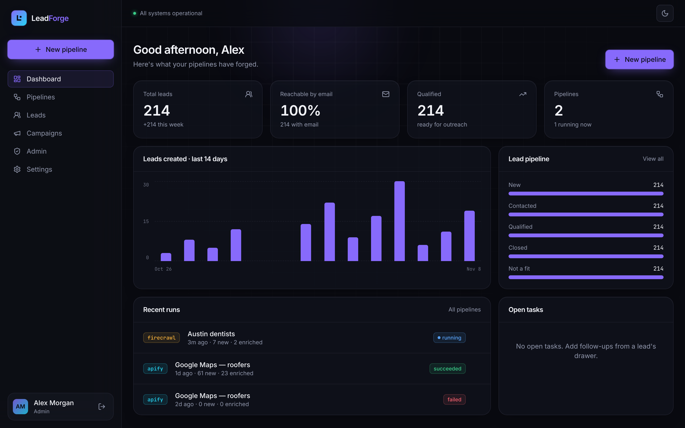
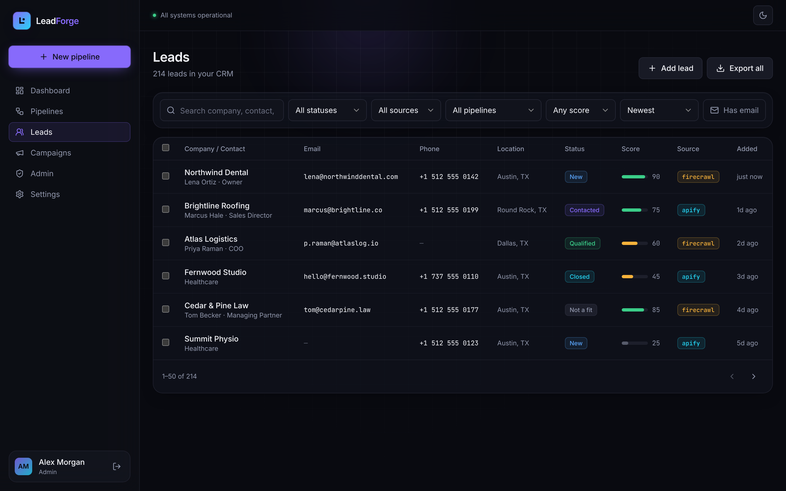
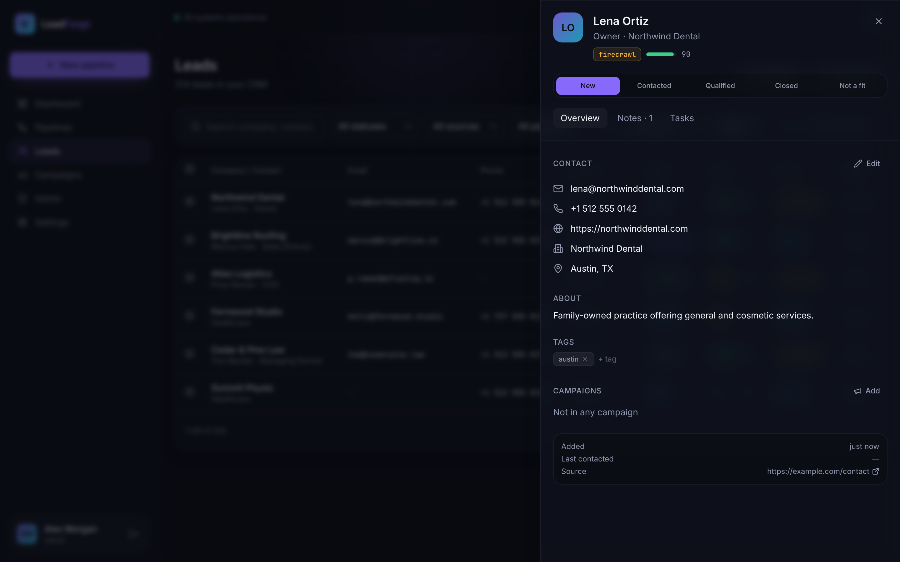

# LeadForge — AI Lead Intelligence & Outreach

Run lead-generation **pipelines** with **Firecrawl** (website crawling + AI extraction) and **Apify** (any scraping Actor),
collect deduped, scored leads in a lightweight **CRM**, group them into **campaigns**, and **export** outreach-ready lists.

**Stack:** Vite + React 18 + TypeScript · Tailwind CSS (dark-first design tokens, light toggle) · Framer Motion ·
TanStack Query · **Lovable Cloud** (Supabase Postgres, Auth, Realtime, Vault, Edge Functions).



| Leads CRM | Lead drawer |
|---|---|
|  |  |

_More in [`docs/screenshots`](docs/screenshots). In-app screens show sample data._

```bash
npm install
cp .env.example .env   # only needed outside Lovable; Lovable Cloud injects these
npm run dev            # http://localhost:8080
```

---

## 1. Page map

| Route | Access | What it does |
|---|---|---|
| `/` | Public | Marketing landing page: hero with product preview, sources, features, workflow, pricing, CTA |
| `/login` | Public (redirects to `/app` if signed in) | Email + password login |
| `/signup` | Public | Create account (**the first user becomes admin**) |
| `/forgot-password` | Public | Send a password reset email |
| `/reset-password` | Public (link from email) | Set a new password |
| `/app` | Signed in | **Dashboard**: KPIs (total, reachable %, qualified, pipelines), 14-day leads chart, status breakdown, recent runs, open tasks |
| `/app/pipelines` | Signed in | Pipeline cards with source, last-run status |
| `/app/pipelines/new?source=firecrawl\|apify` | Signed in | Pipeline builder. Firecrawl: *search / crawl / scrape* modes + extraction prompt. Apify: presets (Google Maps, Contact Details) or any Actor, JSON input, max items, field mapping |
| `/app/pipelines/:id` | Owner | **Run** button, live run history (realtime) with expandable logs & errors, config summary, link to the pipeline's leads |
| `/app/pipelines/:id/edit` | Owner | Edit pipeline |
| `/app/leads` | Signed in | **Leads CRM**: search, filters (status, source, pipeline, score, has-email), sort, pagination, bulk status / add to campaign / CSV / delete, manual "Add lead" |
| `/app/leads?lead=:id` | Owner | **Lead drawer**: status pipeline (New → Contacted → Qualified → Closed / Not a fit), contact info with copy, inline edit, tags, campaigns, **notes**, **tasks** |
| `/app/campaigns` | Signed in | Campaign list + create |
| `/app/campaigns/:id` | Owner | Campaign leads, stats, status, **export** for Instantly / lemlist / HubSpot / Apollo / full CSV (rules: email-only, exclude not-a-fit, mark as contacted) |
| `/app/settings` | Signed in | Profile, theme, password |
| `/app/admin` | **Admin only** | **Admin console**: *Users & roles* (promote/demote), *API keys* (write-only, test connection), *Pipeline runs* (all users, errors filter, logs) |
| `*` | — | 404 |

## 2. Database schema overview

Migration: [`supabase/migrations/20261108000000_leadforge_init.sql`](supabase/migrations/20261108000000_leadforge_init.sql). RLS is on for every table.

| Table | Key columns | Notes / RLS |
|---|---|---|
| `profiles` | `id → auth.users`, email, full_name, company | Auto-created by trigger on signup. Read own (admins read all); update own |
| `user_roles` | user_id, role (`admin`\|`member`) | Roles live in their own table (no privilege escalation via profile edits). `has_role()` / `is_admin()` are `SECURITY DEFINER`. Only admins insert/delete; admins can't demote themselves |
| `pipelines` | owner_id, name, source (`firecrawl`\|`apify`), `config jsonb`, last_run_at | Owner CRUD; admins read |
| `pipeline_runs` | pipeline_id, owner_id, status (`queued/running/succeeded/failed/cancelled`), items_scanned, leads_found/created/updated, error, external_run_id, external_dataset, `log jsonb`, ingest_claimed_at | **Written only by edge functions** (service role). Clients read own; admins read all. On realtime publication |
| `pipeline_run_secrets` | run_id, webhook_secret | Per-run Apify webhook token. RLS on with **no policies**, so the client can't read it at all |
| `leads` | owner_id, pipeline_id, run_id, source, status (`new/contacted/qualified/closed/not_a_fit`), company_name, contact_name, title, email, phone, website, domain, linkedin_url, location, industry, description, score 0–100, tags[], source_url, raw jsonb, **dedupe_key** (generated) | `unique(owner_id, dedupe_key)`: dedupe by email → domain → company+phone. Re-runs *enrich* empty fields and never overwrite your edits or status |
| `lead_notes` | lead_id, author_id, body | Access goes through lead ownership |
| `lead_tasks` | lead_id, owner_id, title, due_at, completed_at | Shown on the lead drawer + dashboard |
| `campaigns` | owner_id, name, description, channel, status (`draft/active/paused/completed`) | Owner CRUD |
| `campaign_leads` | campaign_id, lead_id (PK both) | Can only link your own leads to your own campaigns |

Functions: `handle_new_user()` (profile + role, first user is admin), `lead_daily_counts(days)` (dashboard chart),
`set_integration_secret / get_integration_secret / integration_secret_status` (Vault, **service-role only**).

### Edge functions (`supabase/functions/`)

| Function | Auth | Purpose |
|---|---|---|
| `firecrawl-pipeline` | User JWT, owner check | Creates a run, returns immediately, then works in the background (`EdgeRuntime.waitUntil`): `/search` → `/map` (contact/about/team pages) → `/scrape` with JSON-schema extraction. Emails are checked against the page text, so the AI can't invent them. Then normalize, score, dedupe and ingest |
| `apify-pipeline` | User JWT, owner check | `start`: calls `POST /v2/acts/{actor}/runs` with an ad-hoc webhook. `sync`: polls the run and ingests the dataset when it has finished (fallback if the webhook is missed) |
| `apify-webhook` | Per-run secret token (`verify_jwt=false`) | Apify calls this when a run finishes. It ingests `GET /v2/datasets/{id}/items` exactly once (atomic `ingest_claimed_at` claim) |
| `admin-api-keys` | User JWT + admin role | Key status (never values), set/rotate/delete Vault keys, test the connection against the provider |

Shared: `_shared/leads.ts` (normalize, regex email/phone fallback, scoring, dedupe/enrich), `_shared/apify.ts`
(item mapper for Google Maps / contact scraper / LinkedIn-style outputs, plus optional `field_map`), `_shared/secrets.ts`.

## 3. Where to put the Firecrawl and Apify keys

**Never** in `VITE_*` variables, in client code, or in the database tables. Only the edge functions read them.
They are resolved in this order (see `supabase/functions/_shared/secrets.ts`):

1. **Lovable Cloud secrets (recommended)**
   - **Firecrawl**: in Lovable, open **Connectors → Firecrawl** and connect it. This sets `FIRECRAWL_API_KEY` as a secret for your edge functions. Or add `FIRECRAWL_API_KEY` by hand under **Cloud → Secrets**.
   - **Apify**: in Lovable, open **Cloud → Secrets** and add `APIFY_API_TOKEN` (from Apify Console → Settings → API & Integrations).
   - For a plain Supabase project: `supabase secrets set FIRECRAWL_API_KEY=... APIFY_API_TOKEN=...`
2. **Admin Console → API keys** (fallback / rotation without redeploying): an admin pastes a key and it is stored encrypted in **Supabase Vault** through the `admin-api-keys` function. The page is write-only: it shows whether a key is set and when, never the value. Environment secrets take priority.

After adding keys, use **Admin → API keys → Test connection** to verify them.

## Notes & next steps
- The landing-page pricing tiers and the hero dashboard numbers are placeholder marketing copy. Edit them in `src/pages/Landing.tsx`.
- Data is scoped per user (admins can read everything for oversight). For multi-seat teams, add a `workspaces` table and swap `owner_id` checks for workspace membership in the RLS policies.
- Comply with GDPR / CAN-SPAM and each source's terms when you scrape and contact leads.
